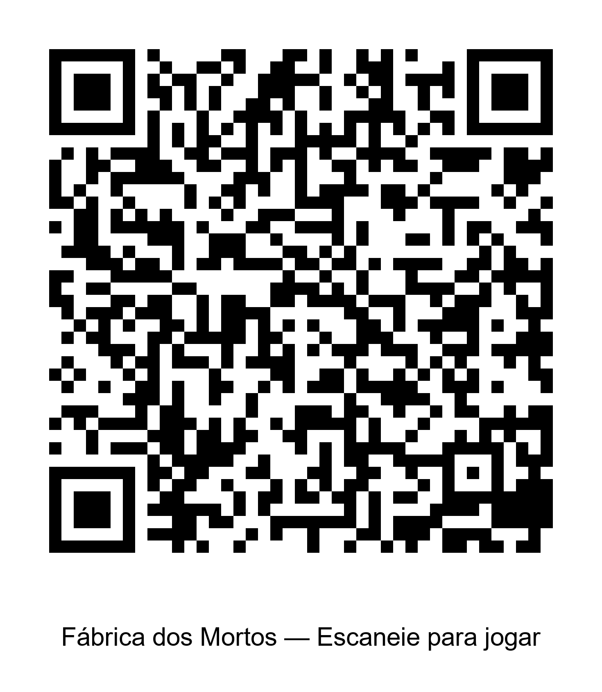

# Fábrica dos Mortos

**Defenda. Recarregue. Resista.**

Jogo de estratégia e defesa em faixas, para um jogador, desenvolvido em **Python e Pygame-CE**. Monte uma formação de soldados, administre suprimentos e munição e enfrente infectados em três regiões: Cidade, Deserto e Cachoeira.

**[Jogar no navegador](https://phillipeafaria.github.io/Criacao_Jogo__Programacao_Para_Jogos/)** · **[QR Code para jogar](web/QR_Code/Fabrica_dos_Mortos_QR_identificado.png)** · [Como contribuir](CONTRIBUTING.md) · [Guia da versão web](web/README.md)

> Versão técnica: **1.6.0 — Alfa da Beta 5**, conforme [project.toml](project.toml). O jogo web está publicado no GitHub Pages. A versão Windows pode ser executada pelos fontes ou empacotada localmente; este README não oferece um instalador pronto.

## Índice

- [Sobre o jogo](#sobre-o-jogo)
- [Como jogar](#como-jogar)
- [Mapas e dificuldades](#mapas-e-dificuldades)
- [Unidades e inimigos](#unidades-e-inimigos)
- [Modos e menus](#modos-e-menus)
- [Controles](#controles)
- [Perfil, loja e progresso](#perfil-loja-e-progresso)
- [Jogar no computador e celular](#jogar-no-computador-e-celular)
- [Executar no Windows](#executar-no-windows)
- [Desenvolver, testar e publicar](#desenvolver-testar-e-publicar)
- [Estrutura do projeto](#estrutura-do-projeto)
- [Problemas comuns](#problemas-comuns)
- [Equipe, créditos e licença](#equipe-créditos-e-licença)

## Sobre o jogo

A campanha acompanha a contaminação ligada à Félix em uma cidade em quarentena, uma escavação no Egito e uma cachoeira em Minas Gerais. Cada região tem cenário, elenco e ameaças próprios. O menu **História do jogo** apresenta a narrativa em quadrinhos.

O desafio combina posicionamento, economia e escolha de tropas. Alcance, resistência, recarga e habilidades tornam importante distribuir a defesa e escolher respostas diferentes para grupos, inimigos blindados, rastejantes e ameaças aquáticas.

| Recurso | Implementação |
|---|---|
| Campanha | Três regiões, com 12 ondas por batalha regional |
| Campo | Quatro faixas de combate |
| Tropas da campanha | Oito cartas por região, totalizando 24 cartas regionais |
| Dificuldades | Fácil, Médio e Difícil |
| Conteúdo | Soldados, infectados comuns, subchefes e chefes regionais |
| Recursos | Suprimentos, munição, recarga e consumíveis |
| Persistência | Perfil, preferências, progresso, retomada e ranking local |
| Testes de unidades | Laboratório separado da campanha |
| Plataformas | Windows pelos fontes/pacote local; navegador em computador e celular |

## Como jogar

1. Abra **Iniciar**, cadastre seu nome quando solicitado e escolha a dificuldade.
2. Selecione uma região disponível. A campanha começa na Cidade; as regiões seguintes dependem da conclusão da anterior.
3. Escolha uma carta e clique ou toque em uma casa válida para posicionar a tropa. Cada unidade consome suprimentos.
4. Organize sua economia e cobertura de tiro. Tropas geradoras fornecem recursos; tropas armadas precisam recarregar.
5. Use a pausa para avaliar o campo e o comando **Próxima onda** quando estiver disponível.
6. Proteja as quatro faixas e conclua as 12 ondas. A invasão da base ameaça a partida; cada faixa possui sua contenção inicial própria.

Há cinco segundos de preparação antes do primeiro inimigo. Os suprimentos não têm teto de reserva. Vida e dano dos inimigos não aumentam automaticamente com o número da onda; a dificuldade escolhida ainda aplica seus modificadores.

As fichas em **Personagens** ajudam a consultar vida, dano, alcance ou velocidade, função e habilidades. Os atributos exatos e as regras vigentes estão nos [dados de conteúdo](src/svz/content.py) e no [catálogo de defensores](src/svz/roster.py); valores de imagens e relatórios antigos podem estar desatualizados.

## Mapas e dificuldades

| Região | Local | Campo e identidade | Desbloqueio |
|---|---|---|---|
| Cidade | Nova York — Terminal Félix | Quatro pistas urbanas, quarentena e forças policiais | Inicial |
| Deserto | Egito — Escavação Félix | Quatro trilhas de areia, ruínas e necrópole contaminada | Após a Cidade |
| Cachoeira | Minas Gerais — Cachoeira Contaminada | Duas faixas terrestres e dois canais centrais; tropas navais e infectados aquáticos | Após o Deserto |

| Dificuldade | Suprimentos iniciais | Perfil |
|---|---:|---|
| Fácil | 320 | Mais recursos e inimigos menos resistentes; indicada para aprender |
| Médio | 240 | Experiência de referência para economia e composição da defesa |
| Difícil | 190 | Menos recursos iniciais, inimigos mais fortes e maior pressão |

As dificuldades também ajustam geração de suprimentos, quantidade e intervalo dos inimigos, dano e habilidades. Consulte `DIFFICULTIES` em [content.py](src/svz/content.py) para os multiplicadores completos.

## Unidades e inimigos

### Tropas disponíveis na campanha

| Cidade | Deserto | Cachoeira |
|---|---|---|
| Xerife de Rua | Pistoleiro do Deserto | Marinheiro |
| Agente Tático da SWAT | Fuzileiro do Deserto | Fuzileiro da Marinha |
| Operador de Rádio Policial | Torre de Rádio do Egito | Estação Móvel da Cachoeira |
| Atirador de Precisão | Atirador do Horizonte | Atirador de Precisão Naval |
| Agente de Entrada | Tenente Artilheiro | Bombeiro Hidráulico |
| Especialista Antipraga | Incinerador do Deserto | Granadeiro das Profundidades |
| Lançador de Foguetes | Nômade do Morteiro | Barco de Patrulha |
| Escudeiro da Tropa de Choque | Guardião de Lâminas | Submarino Tático |

O elenco reúne geração de recursos, fogo rápido, precisão, explosivos, efeitos elementais e combate próximo. Barco de Patrulha e Submarino Tático ocupam duas casas e usam os canais aquáticos. A lista acima representa as cartas ativas da campanha; definições auxiliares no código não significam cartas selecionáveis.

### Ameaças regionais

| Cidade | Deserto | Cachoeira |
|---|---|---|
| Infectado Urbano | Desperto de Khepra | Afogado da Cachoeira |
| Corredor do Metrô | Corredor da Necrópole | Corredor da Trilha |
| Rastejador dos Túneis | Rastejador Mumificado | Rastejador do Cânion |
| Policial Infectado da Félix | Arqueiro da Necrópole | Surfista Infectado |
| Cientista da Félix | Hospedeiro de Escaravelhos | Mergulhador Blindado |
| Técnico da Subestação | Saqueador Canópico | Pescador da Praga |
| Demolidor do Metrô | Zumbi de Lâmina | Baiacu Mutante |
| Bruto da Quarentena | Sacerdote da Praga | Salva-Vidas Colossal |
| Comandante Infectado | Executor da Escavação | Caçador das Profundidades |
| Diretor Demolidor da Félix | Guardião Anúbis Contaminado | Bruto da Cachoeira |
| Comandante Isotópico | Comandante da Necrópole | Caçador Abissal |
| Diretor Zero Corrosivo | Colosso da Pirâmide | Colosso do Véu Verde |

Ataques, defesas e habilidades variam por unidade. Consulte as fichas do jogo e experimente no laboratório para comparar alcance, cadência e comportamento. As três últimas linhas apresentam os chefes regionais.

## Modos e menus

- **Campanha:** progressão pelas regiões, ondas, dificuldades e resultados.
- **Continuar:** retoma a batalha salva quando houver uma partida disponível.
- **Perfil / Loja:** nome do jogador, créditos e compra de consumíveis.
- **Personagens:** fichas das unidades e suas funções.
- **História do jogo:** apresentação narrativa dos cenários.
- **Configurações:** áudio, modo de controle, remapeamento, texto ampliado, pausa automática e movimento reduzido.
- **Como jogar:** instruções dentro do jogo.
- **Ranking / histórico:** resultados registrados localmente, sem competição online global.
- **Laboratório:** ambiente descartável para testar soldados e zumbis, separados por Cidade, Deserto e Cachoeira. Permite posicionar unidades, pausar, controlar a simulação e inspecionar animações e hitboxes. Não avança a campanha nem salva uma batalha de laboratório sobre a campanha.

## Controles

### Mouse e teclado

| Comando padrão | Ação |
|---|---|
| Clique | Interagir com menus, selecionar cartas e posicionar tropas |
| 1 a 8 | Selecionar uma carta |
| P | Pausar / retomar a batalha |
| Esc | Voltar ou cancelar a ação atual, conforme a tela |
| F5 | Salvar |
| F11 | Alternar tela cheia |
| F1 | Consultar detalhes da carta |
| R | Selecionar recolhimento da tropa / retorno à base |
| N ou Tab | Próxima onda, quando disponível |
| H | Selecionar kit médico; depois clicar na tropa |
| T | Selecionar munição tática; depois clicar na tropa |
| F12, no menu principal | Abrir o laboratório |
| W/A/S/D ou setas | Mover o cursor no modo teclado |
| Q / E | Carta anterior / seguinte no modo teclado |
| Enter, F ou Espaço | Posicionar / remover no modo teclado |

As teclas remapeáveis e seus atalhos estão em [settings.py](src/svz/settings.py). Alguns comandos dependem da tela: no laboratório, por exemplo, Espaço controla a pausa.

### Toque e navegador

Toque nas cartas e nas casas para jogar. Durante a batalha, **Tela cheia**, **Kit médico** e **Munição** ficam entre Pontos e Próxima onda. **⋯** abre os demais comandos, incluindo som, salvamento, exportação e seleção de unidade. No menu web, o laboratório também pode ser aberto pelo botão correspondente.

Use o celular na horizontal. A tela cheia preserva a proporção 16:9 e não corta as pistas; aparelhos mais largos podem apresentar faixas laterais. O suporte à tela cheia nativa depende do navegador. Ao trocar de guia, a batalha é pausada e deve ser retomada pelo jogador.

## Perfil, loja e progresso

O perfil guarda o nome usado nos registros locais, créditos e estoque de itens. A loja oferece **Kit médico** (60 créditos) e **Munição tática** (80 créditos). Compre antes da batalha, selecione o item e escolha uma tropa válida. As condições e o efeito são apresentados na loja; Esc cancela a seleção.

A pontuação vem dos inimigos derrotados e aparece durante a batalha e no resultado. Novas partidas começam com zero; continuar preserva a contagem. Ranking e histórico pertencem aos dados locais, sem conta na nuvem ou sincronização automática entre dispositivos.

| Versão | Onde os dados ficam | Cuidados |
|---|---|---|
| Windows | `%LOCALAPPDATA%\SoldadosVsZumbis-Beta5` | Preserve a pasta ao trocar de instalação |
| Web | Armazenamento local do navegador, associado ao endereço do site | Limpar dados do site pode apagar o progresso; use **Exportar progresso** para obter uma cópia |
| Laboratório | Simulação descartável | Não substitui o save da campanha |

O nome técnico antigo da pasta Windows é mantido por compatibilidade. A migração inicial copia dados de `SoldadosVsZumbis` quando aplicável, sem apagar os originais. O formato atual de campanha é schema 4, com leitura de versões 1, 2 e 3. Saves Windows e web são separados; exportar não implica uma função de importação ou transferência automática.

## Jogar no computador e celular

1. Abra **[a página pública do jogo](https://phillipeafaria.github.io/Criacao_Jogo__Programacao_Para_Jogos/)** ou escaneie o QR Code abaixo.
2. Aguarde o carregamento e toque na página para permitir o áudio, caso o navegador solicite interação.
3. No celular, gire para a horizontal e use **Tela cheia** durante a batalha.
4. Para atualizar, recarregue a página. Não apague os dados do site para fazer uma atualização comum.



O download inicial do pacote é de aproximadamente **42,4 MiB**, além do runtime externo do Pygbag. As animações são carregadas por mapa; o conjunto completo tem aproximadamente **163 MiB**. O cache pode reduzir downloads posteriores, mas não garante uso offline. A primeira abertura requer internet.

Há testes automatizados no Chrome com emulação móvel e relatos de uso em celular físico. A emulação não comprova compatibilidade com todos os aparelhos, qualidade sonora real ou desempenho de uma campanha completa. Consulte os procedimentos e limites em [web/README.md](web/README.md).

## Executar no Windows

Requisitos de desenvolvimento: **Python 3.12 x64**, Windows e internet para instalar dependências. Não há especificação mínima de hardware aferida para todos os cenários.

### Inicialização pelos arquivos BAT

1. Baixe ou clone o repositório completo.
2. Execute `PREPARAR_AMBIENTE.bat` uma vez.
3. Execute `JOGAR.bat`.

### Instalação manual no PowerShell

Na raiz do repositório:

```powershell
py -3.12 -m venv .venv
.\.venv\Scripts\python.exe -m pip install -r requirements.txt
.\.venv\Scripts\python.exe main.py
```

As dependências de execução são Pygame-CE, NumPy e PyOpenGL, fixadas em [requirements.txt](requirements.txt). A renderização padrão é por software; OpenGL é opcional, usando `SVZ_RENDERER=opengl`.

Para gerar o executável, execute `CRIAR_EXE.bat` ou siga o guia de desenvolvimento. O nome técnico `SoldadosVsZumbis.exe` permanece no empacotamento. Distribua o pacote completo, com seus recursos, não apenas o executável. Builds e ambientes virtuais não devem ser enviados ao Git.

## Desenvolver, testar e publicar

### Testes e qualidade

```powershell
.\.venv\Scripts\python.exe -m pip install -r requirements-test-lock.txt
.\.venv\Scripts\python.exe tools/manage.py check
.\.venv\Scripts\python.exe tools/manage.py test
```

Para a análise ampliada, execute `tools/quality.py` com o mesmo interpretador. Ela reúne testes, cobertura, diagnóstico e outras verificações; resultados locais ficam em `reports/`. Use `SVZ_DATA_DIR` para isolar dados de testes manuais dos saves pessoais.

Testes automatizados verificam regras e regressões, mas não substituem inspeção visual, escuta do áudio e teste em celular físico. Relatórios antigos não certificam o estado atual: consulte as execuções na aba **Actions** e a documentação de [pendências e testes](docs/PENDENCIAS_TESTES.md).

### Gerar a versão web

```powershell
py -3.12 -m venv .venv-web
.\.venv-web\Scripts\python.exe -m pip install -r web/requirements-build.txt
.\.venv-web\Scripts\python.exe -X utf8 web/generate.py
```

A geração trabalha em `.web-build/`, aplica os adaptadores de navegador à cópia e verifica recursos e animações. O resultado fica em `.web-build/web_game/build/web/`. Para prévia local, testes de navegador e atualização de `web/site/`, siga [o guia web](web/README.md).

A publicação usa **GitHub Pages** neste repositório. Após revisar e integrar os arquivos gerados e seu manifesto, execute manualmente o workflow **Publicar Fabrica dos Mortos**. Fazer commit ou merge não publica automaticamente. Mantenha o endereço para que os QR Codes existentes continuem funcionando.

### Fluxo de contribuição

Uma tarefa por Issue, uma branch curta por alteração e um Pull Request para `main`. Descreva o resultado, os testes e as limitações; resolva a revisão e aguarde as verificações obrigatórias. Não inclua saves, ambientes virtuais ou alterações de colegas sem identificar sua contribuição.

Guias: [Contribuição](CONTRIBUTING.md) · [Organização da equipe](docs/ORGANIZACAO_EQUIPE.md) · [Desenvolvimento](docs/DESENVOLVIMENTO.md) · [Histórico de alterações](CHANGELOG.md).

## Estrutura do projeto

| Caminho | Responsabilidade |
|---|---|
| `main.py` e `project.toml` | Entrada e identificação da versão |
| `src/svz/` | Código compartilhado do jogo |
| `src/svz/content.py` e `roster.py` | Regiões, elencos e atributos |
| `src/svz/battle.py` e módulos de combate | Simulação, ataques, projéteis e ondas |
| `src/svz/production_animations.py` e módulos de desenho | Animações e renderização |
| `assets/` | Cenários, sprites, efeitos, áudio e manifesto |
| `tests/` | Testes do jogo |
| `tools/` | Qualidade, diagnóstico e empacotamento |
| `web/runtime/`, `web/patches/` e `web/ui/` | Adaptação Python e interface de navegador |
| `web/tools/`, `web/tests/` e `web/generate.py` | Geração e validação web |
| `web/site/` e `web/manifest.json` | Pacote preparado para publicação e hashes |
| `web/QR_Code/` | QR Codes PNG/SVG, simples e identificados |
| `.github/` | Workflows e modelos de colaboração |
| `docs/` e `docs/historico/` | Guias e registros de versões anteriores |
| `licenses/` e `CREDITOS.md` | Licenças de dependências e procedência dos recursos |
| `reports/`, `dist/`, `.web-build/` | Saídas locais geradas, não fontes de desenvolvimento |

Não mova ou renomeie recursos sem atualizar suas referências. Preserve a separação entre fontes, pacotes gerados e dados pessoais.

## Problemas comuns

| Sintoma | O que conferir |
|---|---|
| Primeira abertura web demorada | Aguarde o download das artes e mantenha a guia aberta; confira a conexão |
| Sem som no navegador | Toque na página, confira o comando Som, o volume do aparelho e se a guia está silenciada |
| Áudio estranho após trocar de guia | Recarregue a versão atual; informe aparelho, navegador e passos para reproduzir se persistir |
| Jogo pequeno no celular | Use orientação horizontal e Tela cheia; os controles extras ficam em ⋯ |
| Progresso não aparece em outro aparelho | O armazenamento é local; não há sincronização automática |
| Erro ao abrir pelos fontes | Execute o preparador e confirme Python 3.12 x64 e dependências |
| Executável não reflete mudanças | Recompile; o executável antigo não acompanha alterações nos fontes |
| Falha gráfica com OpenGL | Teste a renderização padrão por software e registre o erro |

Ao abrir uma Issue, inclua versão, sistema/aparelho, navegador quando aplicável, passos para reproduzir e captura ou vídeo. No Windows, consulte `jogo.log` na pasta de dados. Não envie saves pessoais ou informações sensíveis sem revisar seu conteúdo.

## Equipe, créditos e licença

O código é distribuído sob a [licença MIT](LICENSE), com os avisos de autoria existentes preservados. Consulte [CREDITOS.md](CREDITOS.md) para procedência do áudio e as licenças de terceiros antes de redistribuir recursos.
